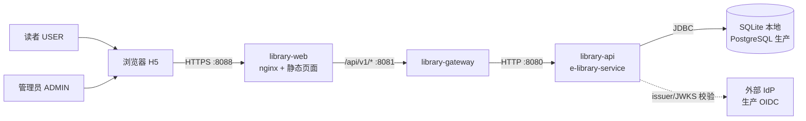
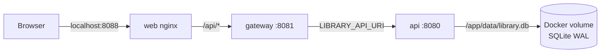
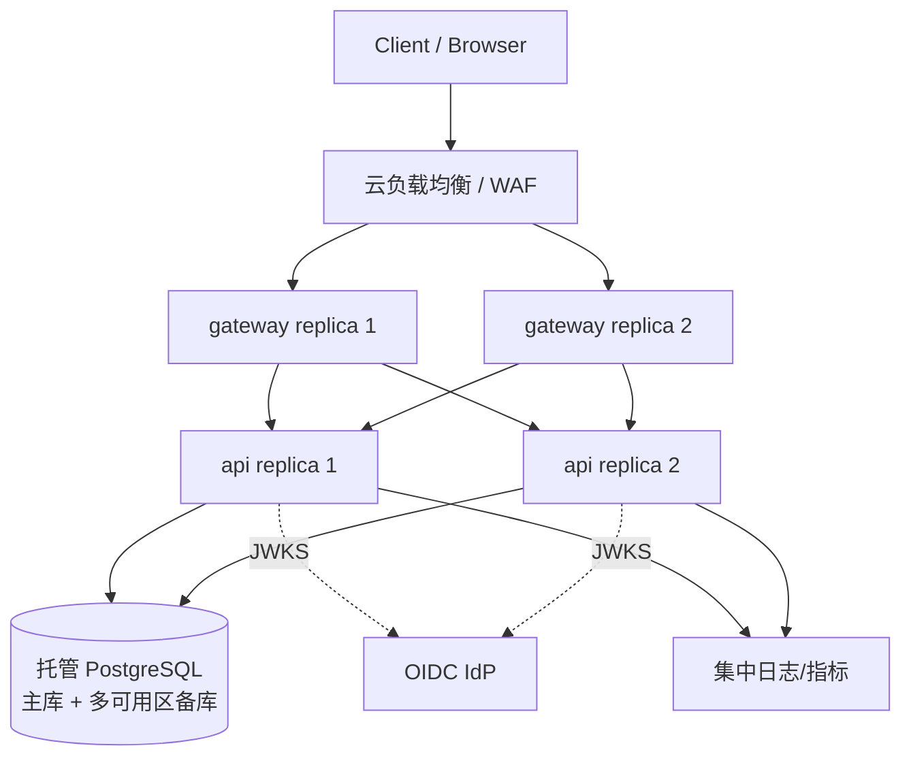
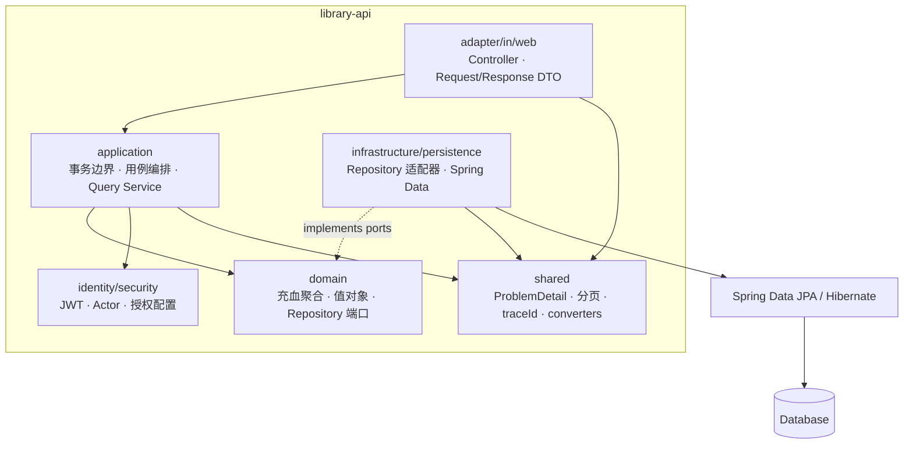
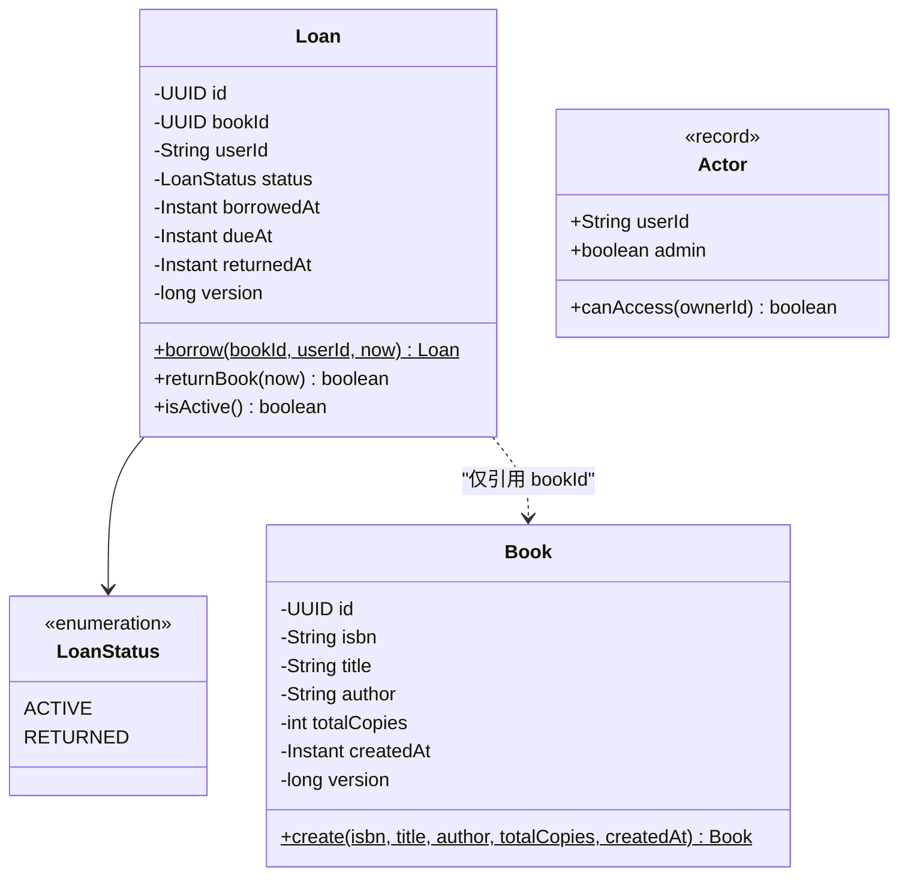
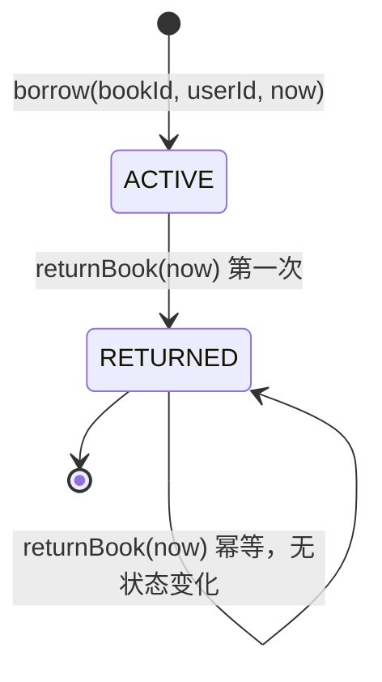
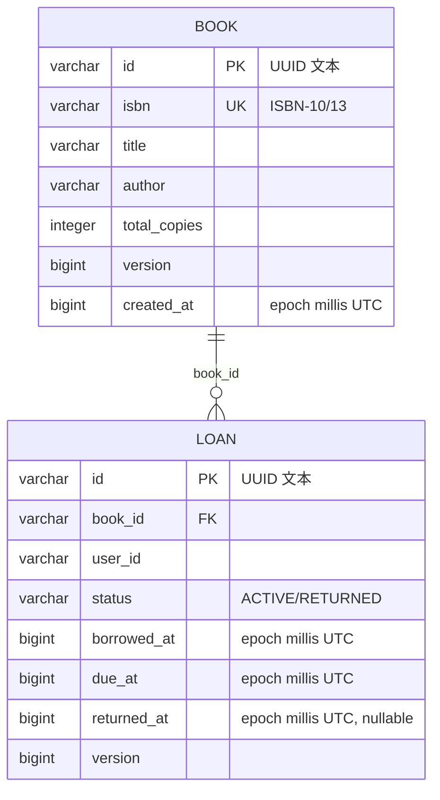
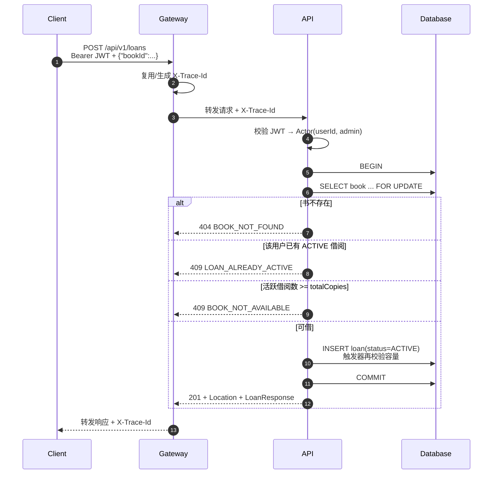
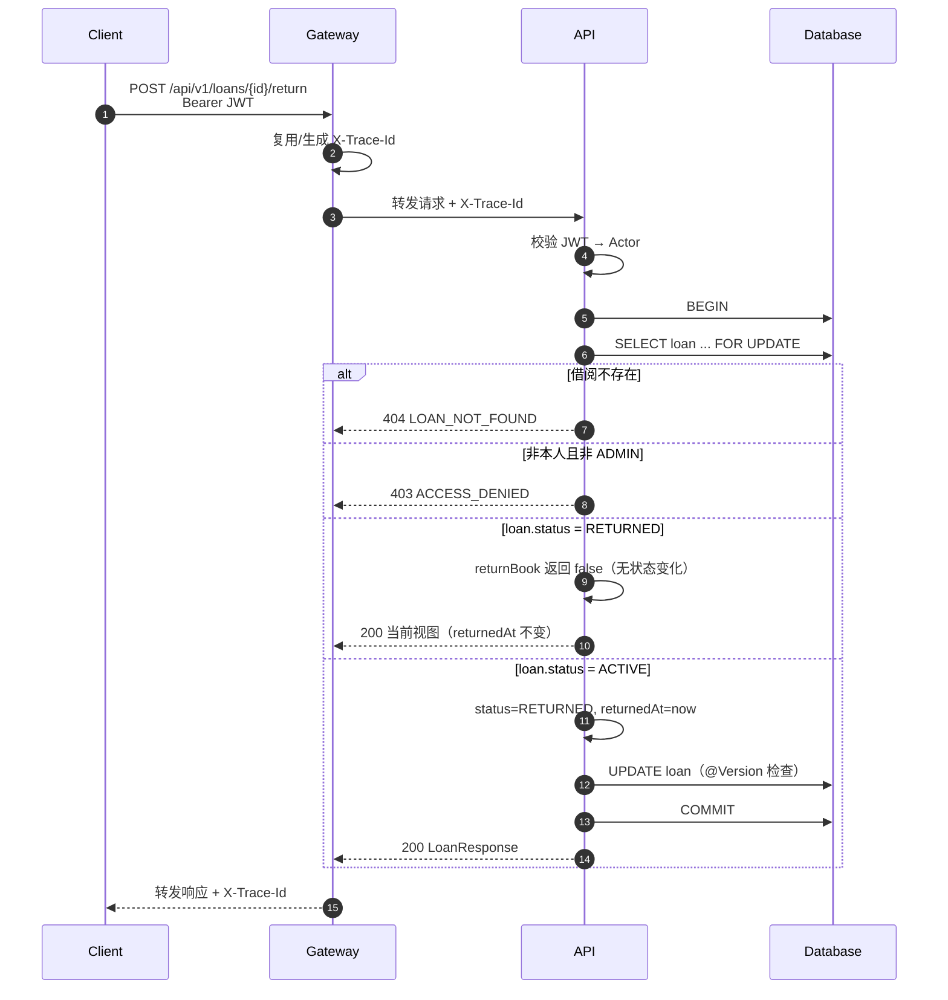

# E-Library Service 架构设计

> 状态：可运行实现  
> 版本：1.0  
> 最后更新：2026-11-08

## 1. 背景、范围与假设

### 1.1 背景

在线图书馆的核心写路径只有**借书**和**还书**，真正的难点是并发正确性：不能超借；同一用户不能同时持有同一本书的两个活跃借阅；归还必须幂等；用户只能操作自己的借阅（ADMIN 例外）；多实例部署下正确性不能依赖 JVM 内存锁。本作业覆盖这些路径，并展示分层、领域模型、安全边界、错误契约、可观测性和测试策略；它**不是**功能齐全的图书馆管理系统。

### 1.2 范围内

- 书目查询：按书名、作者、ISBN 进行不区分大小写的包含搜索，分页。
- 借阅：创建 14 天借期的借阅，校验容量和重复活跃借阅。
- 归还：只能归还活跃借阅；重复归还幂等；本人或 ADMIN 可操作。
- 身份认证与授权：JWT Bearer、`USER`/`ADMIN` 角色、方法级授权、所有权检查。
- 统一错误契约：RFC 7807 ProblemDetail、稳定错误码、traceId。
- 本地一键启动：API、网关、H5 客户端、SQLite 持久卷。
- 生产拓扑说明：PG、OIDC、多实例、健康探针、优雅停机。

### 1.3 范围外

逾期调度、罚金、催还通知、预约/排队、续借、推荐、全文搜索、真实 IdP 登录页、图书管理后台、消息队列、缓存、分布式锁、Kubernetes 清单。原因见 README 的“不在范围内”，演进建议见第 14 节。

### 1.4 假设与约束

| 编号 | 假设/约束 |
| --- | --- |
| A1 | 令牌的 `sub` 是稳定用户标识；用户目录由外部 IdP 管理，本服务不存用户表。 |
| A2 | `roles` claim 是字符串数组，合法角色为 `USER`、`ADMIN`；缺少角色即无权访问业务 API。 |
| A3 | 借期固定 14 天；`dueAt = borrowedAt + Duration.ofDays(14)`；时间统一为 UTC `Instant`，由注入的 `Clock` 提供。 |
| A4 | `Book.totalCopies` 是当前总副本数；本项目不调整库存，不区分馆藏位置。 |
| A5 | “可借”是派生值：`totalCopies - count(ACTIVE loans)`，不在 `book` 表冗余存储。 |
| A6 | 一个用户对一本书最多一个 `ACTIVE` 借阅；归还后可以再次借同一本书。 |
| A7 | 本地开发允许 SQLite；生产必须使用 PostgreSQL。 |
| A8 | 所有业务端点都要求登录，包括书目浏览；不做匿名访问。 |
| A9 | 分页使用偏移分页；`page >= 0`，`1 <= size <= 50`。 |
| A10 | 采用模块化单体，不引入微服务、服务发现、配置中心、Kafka、Redis 或分布式锁。 |

## 2. 质量属性与权衡

| 质量属性 | 目标 | 实现方式 | 代价/权衡 |
| --- | --- | --- | --- |
| 一致性 | 绝不超借；同一用户同一书最多一个活跃借阅 | 数据库事务 + Book 行悲观锁 + 活跃计数 + 部分唯一索引 + 容量触发器 | 热门书上的借阅会串行化；吞吐上限由单行锁决定 |
| 可用性 | 应用无状态，可水平扩展；单实例故障不影响整体 | JWT、无 HTTP Session、外部化配置、readiness/liveness、优雅停机 | SQLite 本地模式不具备多实例高可用，仅用于演示 |
| 性能 | 常规查询毫秒级；借阅事务短小 | 索引 `(book_id,status)`、`(user_id,status)`、`(user_id,borrowed_at DESC)`；批量读取活跃计数与书名 | 搜索使用 `locate`，不适合超大目录；偏移分页深页变慢 |
| 安全 | 身份只来自令牌；最小权限；不泄露内部细节 | OAuth2 resource server、方法级授权、所有权检查、DTO、ProblemDetail、CORS 白名单 | 本地 dev token 是刻意保留的攻击面，生产禁用 |
| 可维护性 | 领域逻辑可独立测试，适配器可替换 | web → application → domain；Repository 端口在 domain；DTO 与实体分离 | 领域对象带最小 JPA 注解，不是“纯净”的六边形模型 |
| 可观测性 | 每个请求可关联，健康状态可探测 | traceId 贯穿网关/API/日志/错误响应；Actuator 探针；关键业务日志 | 未内置 Prometheus/OpenTelemetry 后端 |
| 可测试性 | 核心逻辑不 mock；并发可重复验证 | 领域单测 + PostgreSQL Testcontainers 集成测试 + 真实并发请求 | 集成测试依赖 Docker，启动比纯单测慢 |
| 简单性 | 5 分钟可跑，组件数量最少 | 模块化单体、SQLite 本地、单一路由网关 | 放弃了部分“看起来更云原生”的基础设施 |

## 3. 系统上下文

### 3.1 上下文图



### 3.2 本地部署拓扑



Compose 启动顺序由健康检查控制：`api` 就绪后启动 `gateway`，`gateway` 就绪后启动 `web`。浏览器只访问 8088，属于同源请求；但网关仍按 `Origin` 白名单校验转发流量，因此实际访问地址（包括局域网 IP）必须列入 CORS 白名单。网关和 API 也暴露到宿主机，便于 curl 与 Swagger 调试。

### 3.3 生产部署拓扑



负载均衡只把流量发给 readiness 通过的实例。API 和网关都不保存会话，因此可以按 CPU/延迟水平扩容；数据库是唯一有状态组件，使用托管 PG 的多可用区部署和自动备份。

## 4. 模块划分

### 4.1 Maven 模块

| 模块 | artifactId | 职责 |
| --- | --- | --- |
| `library-api` | `e-library-service` | 业务 API、领域模型、持久化、安全、迁移 |
| `library-gateway` | `library-gateway` | 边缘路由、traceId 注入、健康探针 |
| `library-web` | `library-web` | 静态 H5、nginx 同源代理与安全响应头 |

后端是唯一的可部署业务单元；网关和 Web 是独立的边缘/表现层进程。它们共享的是 API 契约，不是代码。

### 4.2 包结构与依赖方向



硬性规则：

1. Controller 只依赖 application 服务，不直接使用 Repository。
2. DTO 只存在于 web 层；领域实体和 `LoanView`/`BookView` 不直接序列化给客户端。
3. application 只看到 domain 的 Repository 接口，不知道 `JpaRepository`、Hibernate 或 SQL。
4. domain 不依赖 Web、Servlet、Spring Data；JPA 注解仅作为最小持久化元数据，业务方法不调用 ORM API。
5. 聚合之间只通过 ID 引用。`Loan` 有 `bookId`，不持有 `Book` 对象；`Book` 不知道 `Loan` 的存在。

### 4.3 各包职责

| 包 | 关键类 | 说明 |
| --- | --- | --- |
| `catalog` | `Book`, `BookRepository`, `BookQueryService`, `BookController`, `BookPersistenceAdapter` | 书目聚合、ISBN 规范化、搜索与可借数量查询 |
| `loan` | `Loan`, `LoanStatus`, `LoanService`, `LoanQueryService`, `LoanController`, `LoanPersistenceAdapter` | 借阅聚合、状态机、借还事务、所有权检查 |
| `identity` | `Actor`, `Role`, `SecurityConfig`, `DevTokenController` | 调用者身份、资源服务器、角色映射、仅 dev 的令牌签发 |
| `shared` | `GlobalExceptionHandler`, `ProblemDetailsFactory`, `TraceIdFilter`, `PageQuery`, `PageResponse`, 类型 converter | 统一错误、traceId、分页与跨数据库类型映射 |

### 4.4 为什么是模块化单体

- 业务只有两个写用例，独立部署不会带来团队自治收益，反而增加网络失败、分布式事务和运维成本。
- 清晰的分层和模块边界保留了未来拆分 catalog/loan 的可能，但当前不需要服务发现、API 网关聚合多个后端或消息总线。
- 网关的存在是为了统一入口、集中 traceId 和未来的限流/TLS 终止，不是微服务编排。

## 5. 领域模型与不变量

### 5.1 限界上下文

| 上下文 | 聚合根 | 职责 |
| --- | --- | --- |
| Catalog | `Book` | 书目元数据、总副本数、ISBN 规范化 |
| Loan | `Loan` | 借阅生命周期、借期、归还状态 |
| Identity | `Actor`（非持久化） | 从令牌得到的调用者与角色 |
| Shared | — | 分页、错误、时间、持久化基础类型 |

### 5.2 聚合与值对象



设计要点：

- **无 setter**：`Book` 通过静态工厂创建后不可变；`Loan` 只能由 `borrow` 工厂创建，状态只能通过 `returnBook` 改变。
- **业务方法承载规则**：借期计算、毫秒截断、状态转换、幂等归还都在聚合内部完成，application 不拼接字段。
- **聚合间按 ID 引用**：`Loan` 不加载 `Book` 集合；返回书名时由 application 批量查询并组装 view。
- **可借性是查询派生值**：`Book` 只保存 `totalCopies`，避免在 `book` 表维护一个容易与借阅数据不一致的 `availableCopies` 字段。

### 5.3 借阅状态机



`returnBook` 返回 `boolean`：`true` 表示本次调用改变了状态，`false` 表示此前已归还。application 在两种情况下都返回当前借阅视图，且保留第一次归还的 `returnedAt`。

### 5.4 核心不变量与执行层次

| 编号 | 不变量 | 领域/应用层 | 数据库层 |
| --- | --- | --- | --- |
| I1 | 活跃借阅数 ≤ `Book.totalCopies` | 借书事务锁 Book 行后计数并判断 | `trg_loan_capacity_guard` 触发器兜底（PG 并发序列化仍依赖行锁；SQLite 为单写者） |
| I2 | 同一用户同一书最多一个 `ACTIVE` 借阅 | 借书前查询已有活跃借阅 | 部分唯一索引 `uq_loan_active_user_book (user_id, book_id) WHERE status='ACTIVE'` |
| I3 | 只有 `ACTIVE` 可归还；重复归还幂等 | `Loan.returnBook` 内状态判断 | `ck_loan_status`、`ck_loan_returned_at` |
| I4 | `dueAt = borrowedAt + 14 天`，UTC，注入 Clock | `Loan.borrow` 计算并截断毫秒 | `ck_loan_due_date` 校验精确差值 |
| I5 | 只能查看/归还自己的借阅，ADMIN 例外 | `Actor.canAccess` + service 检查 | 不适用（授权在应用层） |
| I6 | `totalCopies >= 1`；ISBN 唯一且格式合法 | `Book.create` 校验、ISBN 规范化 | `ck_book_total_copies`、`uq_book_isbn` |

不变量不是“只靠代码自觉”：应用层负责给出准确的业务错误，数据库约束作为最后防线。即使绕过服务、并发执行或未来新增写入口，数据库也不会产生超借或非法状态。

## 6. API 契约

### 6.1 通用约定

- 前缀：`/api/v1`。
- 内容类型：请求/响应 `application/json`；错误 `application/problem+json`。
- 认证：`Authorization: Bearer <JWT>`；`sub` 是用户 ID，`roles` claim 映射为 `ROLE_USER`/`ROLE_ADMIN`。
- 方法级授权：`@PreAuthorize("hasAnyRole('USER','ADMIN')")`。
- 分页：`page` 默认 0，`size` 默认 20，最大 50；`q` 最大 100 字符。
- 响应头：每个响应都带 `X-Trace-Id`；创建资源带 `Location`。
- 错误：RFC 7807，固定 `code` 字段，`traceId` 与响应头一致。

分页响应使用显式 envelope，而不是 Spring `Page`：

```json
{
  "items": [],
  "page": 0,
  "size": 20,
  "totalElements": 0,
  "totalPages": 0
}
```

### 6.2 端点

| 方法 | 路径 | 授权 | 成功 | 主要错误 |
| --- | --- | --- | --- | --- |
| POST | `/api/v1/dev/tokens` | 匿名，仅 dev+HMAC | 200 Token | 400 校验失败 |
| GET | `/api/v1/books?q=&page=&size=` | USER/ADMIN | 200 分页书目 | 401/403/400 |
| GET | `/api/v1/books/{id}` | USER/ADMIN | 200 书目 | 404 `BOOK_NOT_FOUND` |
| POST | `/api/v1/loans` | USER/ADMIN | 201 + Location | 404 `BOOK_NOT_FOUND`、409 `BOOK_NOT_AVAILABLE`、409 `LOAN_ALREADY_ACTIVE` |
| POST | `/api/v1/loans/{id}/return` | 本人或 ADMIN | 200 借阅 | 404 `LOAN_NOT_FOUND`、403 `ACCESS_DENIED` |
| GET | `/api/v1/loans/{id}` | 本人或 ADMIN | 200 借阅 | 404、403 |
| GET | `/api/v1/me/loans?status=&page=&size=` | USER/ADMIN | 200 分页借阅 | 400 非法状态 |

补充语义：

- 书目搜索 `q` 为空返回全部；匹配书名、作者、ISBN，均不区分大小写，按 `title, id` 稳定排序。
- `status` 只接受 `ACTIVE`/`RETURNED`；其他值返回 `400 MALFORMED_REQUEST`。
- ADMIN 能查看/归还任意用户的借阅；`/me/loans` 始终只返回 token 对应用户自己的记录，不接受 `userId` 参数。
- 重复归还同一个借阅返回 200，不创建新记录，`returnedAt` 不变。
- 借阅创建返回的 `bookTitle` 来自同一次事务读取的书目。

### 6.3 借书请求/响应

`BorrowBookRequest` 只有 `bookId` 字段；请求体即使包含 `userId` 也会被忽略，服务端始终使用 `@CurrentUser Actor`。成功返回 `201`、`Location: /api/v1/loans/{id}` 和借阅视图：

```json
{
  "id": "9f1c...",
  "bookId": "11111111-1111-1111-1111-111111111111",
  "bookTitle": "Clean Code",
  "status": "ACTIVE",
  "borrowedAt": "2026-11-08T06:45:00Z",
  "dueAt": "2026-11-22T06:45:00Z"
}
```

### 6.4 错误模型

```json
{
  "type": "https://elibrary.example/problems/loan-already-active",
  "title": "An active loan already exists",
  "status": 409,
  "detail": "An active loan already exists for this book",
  "instance": "/api/v1/loans",
  "code": "LOAN_ALREADY_ACTIVE",
  "traceId": "c3d1...",
  "errors": [
    {"field": "size", "message": "must be between 1 and 50"}
  ]
}
```

- `type` 是稳定的问题类型 URI；`code` 是机器可读枚举，客户端应基于它分支，而不是解析文案。
- `errors` 只在校验失败时出现。
- 5xx 只返回通用 `INTERNAL_ERROR`；堆栈仅写入服务端日志，并带同一个 traceId。
- 认证失败返回 401 和 `WWW-Authenticate: Bearer realm="e-library"`；权限不足返回 403，不把 403 伪装成 404。

| code | HTTP | 含义 |
| --- | --- | --- |
| `BOOK_NOT_FOUND` | 404 | 书目不存在 |
| `LOAN_NOT_FOUND` | 404 | 借阅不存在 |
| `BOOK_NOT_AVAILABLE` | 409 | 活跃借阅已达总副本数 |
| `LOAN_ALREADY_ACTIVE` | 409 | 该用户已有同一本书的活跃借阅 |
| `CONCURRENT_MODIFICATION` | 409 | 乐观锁冲突，可重试 |
| `DATA_CONFLICT` | 409 | 未映射的数据库约束冲突 |
| `ACCESS_DENIED` | 403 | 已认证但无权限 |
| `UNAUTHORIZED` | 401 | 未认证或令牌无效 |
| `VALIDATION_FAILED` | 400 | 参数/请求体校验失败 |
| `MALFORMED_REQUEST` | 400 | JSON、UUID、枚举值等无法解析 |
| `RESOURCE_NOT_FOUND` | 404 | 无对应路由/静态资源 |
| `METHOD_NOT_ALLOWED` | 405 | HTTP 方法不支持 |
| `INTERNAL_ERROR` | 500 | 未预期异常 |

## 7. 数据模型与约束

### 7.1 ER 图



### 7.2 表与约束

`book`：

- 主键 `id`；`isbn` 唯一；`total_copies > 0`；`version` 由 Hibernate 乐观锁维护。
- `created_at` 存 epoch 毫秒，跨 SQLite/PostgreSQL 行为一致。

`loan`：

- 主键 `id`；外键 `book_id → book(id)`。
- `ck_loan_status` 限制 `ACTIVE`/`RETURNED`。
- `ck_loan_returned_at` 保证状态与归还时间一致：
  - `ACTIVE` 必须有 `returned_at IS NULL`；
  - `RETURNED` 必须有非空 `returned_at`。
- `ck_loan_due_date` 保证 `due_at = borrowed_at + 1209600000`（14 天，单位毫秒）。
- 部分唯一索引 `uq_loan_active_user_book`：只对 `status='ACTIVE'` 生效，因此历史归还记录不会阻止再次借阅。
- 容量触发器：插入或状态变为 `ACTIVE` 时，统计同一本书的活跃借阅数，达到 `total_copies` 则中止事务。

### 7.3 索引

| 索引 | 列 | 服务的查询 |
| --- | --- | --- |
| `uq_book_isbn` | `book(isbn)` | ISBN 唯一性、按 ISBN 精确查找 |
| `uq_loan_active_user_book` | `loan(user_id, book_id) WHERE status='ACTIVE'` | 重复活跃借阅兜底；按用户+书查活跃记录 |
| `idx_loan_user_status` | `loan(user_id, status)` | `/me/loans` 状态过滤与分页 |
| `idx_loan_user_borrowed` | `loan(user_id, borrowed_at DESC)` | 我的借阅按借出时间倒序 |
| `idx_loan_book_status` | `loan(book_id, status)` | 活跃计数、容量触发器 |

书目搜索使用 `lower(title/author/isbn) + locate`，没有为包含搜索建 B-tree 索引；这是当前数据量下的有意简化。大规模部署应改为 PostgreSQL `pg_trgm` 或 FTS，并采用游标分页。

### 7.4 迁移策略

```
db/migration/common/V1__create_schema.sql       表、约束、索引
db/migration/sqlite/V2__loan_capacity_guard.sql SQLite 触发器
db/migration/postgresql/V2__loan_capacity_guard.sql PG 触发器函数
db/seed/V3__seed_books.sql                      仅本地 profile 的 8 本种子书
```

- Flyway locations：`common` + `{vendor}`；默认本地配置额外包含 `seed`；测试/生产不加载 seed。
- Hibernate 使用 `ddl-auto: validate`，不会悄悄改表。
- 迁移只前进，不在运行时自动改结构；生产发布应先在预发验证。
- Flyway 在 PostgreSQL 上使用 schema history 锁，多个实例同时启动时会串行执行迁移。

### 7.5 类型可移植性

- UUID 统一存为 `VARCHAR(36)`，避免 SQLite 无原生 UUID 类型；主键字段使用 `@JdbcTypeCode(SqlTypes.VARCHAR)`，非主键 UUID 使用 `AttributeConverter`。
- `Instant` 通过 `AttributeConverter` 存为 epoch 毫秒 `BIGINT`，避免 SQLite 文本日期格式与 PG `timestamptz` 的差异。
- 时间在写入前截断到毫秒，保证 API 响应与数据库值一致。

## 8. 借阅与归还时序

### 8.1 借书



认证在 API 进程内由 Spring Security 资源服务器过滤器完成，没有独立的 Security 服务，也没有额外网络跳转。

关键点：

- **先锁 Book 行，再计数**。同一本书的所有借书事务在该行上排队，后续计数读到的是前一个事务提交后的结果。
- 锁的顺序固定为“先 Book，后 Loan 插入”；没有多行交叉加锁，死锁风险低。
- 插入时数据库触发器再次检查容量；即使行锁在 SQLite 上不生效，也不会超借。
- `saveAndFlush` 让约束冲突在事务内抛出，适配器将其翻译为领域错误（部分唯一索引 → `LOAN_ALREADY_ACTIVE`，触发器标记 → `BOOK_NOT_AVAILABLE`）。

### 8.2 归还



应用层没有显式调用 `save`：`findByIdForUpdate` 返回的是受管实体，事务提交时 Hibernate 脏检查会写入更新。`@Version` 防止在锁不可用的数据库上丢失更新；触发器/状态机保证语义正确。

### 8.3 可借数量读取

- `GET /books` 先分页查书目，再按当前页的 book IDs 做一次分组计数，避免 N+1。
- `GET /books/{id}` 单独计数。
- 可借数量是**读时快照**：页面显示后可能被其他用户借走；真正借书时以事务内检查为准，客户端应对 409 `BOOK_NOT_AVAILABLE` 做刷新提示。

## 9. 并发与一致性

### 9.1 为什么不能只靠“先查后插”

两个事务同时读到 `active=2, total=3`，都认为还剩 1 本，然后各自插入，最终 `active=4`。唯一索引只能防止同一用户重复借同一本书，不能防止不同用户超借。因此容量约束必须与计数在同一临界区内完成。

### 9.2 PostgreSQL 生产方案

1. `findByIdForUpdate` 生成 `SELECT ... FOR UPDATE`，同一本书的借书事务串行化，不同书互不阻塞。
2. 在持锁事务内先检查该用户已有活跃借阅，再执行 `count(ACTIVE)`，最后插入 `loan`；重复借阅优先返回更准确的 `LOAN_ALREADY_ACTIVE`。
3. 部分唯一索引兜底“同用户同书一个活跃借阅”；BEFORE INSERT/UPDATE 触发器是单条写入的最后防线。在 READ COMMITTED 下触发器本身不是并发序列化机制，**任何新增写路径仍必须先锁 Book 行**。
4. `@Version` 检测 Book/Loan 的并发修改，冲突映射为 409 `CONCURRENT_MODIFICATION`。

隔离级别使用默认的 READ COMMITTED：所有借书方先竞争同一行锁，计数语句看到的是已提交状态；不需要 SERIALIZABLE 带来的重试成本。

### 9.3 SQLite 本地方案

- SQLite 写事务本身串行化，适合单机演示，但**不支持 `SELECT ... FOR UPDATE`**（Hibernate 会忽略锁提示）。
- WAL + `busy_timeout=5000` 改善读写并发，但不改变“单写者”本质。
- JDBC URL 设置 `transaction_mode=IMMEDIATE`：事务在 `BEGIN` 时即取得 SQLite 写预留锁，而不是等到首次 INSERT。否则“先读后写”的延迟事务在另一个连接提交后会触发 `SQLITE_BUSY_SNAPSHOT`，表现为并发借书 500，且 `busy_timeout` 无法挽救已经失效的快照。
- 数据库触发器 `trg_loan_capacity_guard_insert/update` 在插入和更新时检查容量，是本地模式的最终防线。
- 部分唯一索引保证重复活跃借阅不可能出现。
- `SqliteConcurrencyIT` 用真实 SQLite 文件、12 个并发请求验证容量与同用户唯一性，并断言本地 URL 启用了 IMMEDIATE 模式。
- 因此 SQLite 版本在单实例下仍然正确，但**不具备多实例高可用能力**；生产必须切换到 PostgreSQL。

### 9.4 归还并发

- 归还先锁 `loan` 行（PG），两个并发归还请求串行。
- 第一个请求将状态改为 `RETURNED` 并提交；第二个请求随后读到 `RETURNED`，`returnBook` 返回 `false`，返回同一个 `returnedAt`。
- SQLite 上写事务以 IMMEDIATE 模式串行化，并发归还仍由聚合的 `returnBook` 收敛到同一个 `returnedAt`；`@Version` 继续防御异常路径，冲突映射为 409 `CONCURRENT_MODIFICATION`，客户端可安全重试。

### 9.5 多实例

- JWT 无状态认证，无 Session、无本地缓存，任何实例都能处理任何请求。
- 不使用 `synchronized`、`ConcurrentHashMap` 锁或本地锁；协调点是数据库行锁和约束。
- 网关和 API 都可水平扩容；SQLite 部署仅限单实例。
- 未使用分布式锁：数据库事务本身已经提供所需临界区，Redis 锁会引入额外故障模式和 TTL 正确性问题。

### 9.6 失败与重试

| 场景 | 结果 | 客户端建议 |
| --- | --- | --- |
| 并发超借 | 一个成功，其余 409 `BOOK_NOT_AVAILABLE` | 刷新可借数量，不要盲目重试 |
| 重复借同一本 | 409 `LOAN_ALREADY_ACTIVE` | 跳转到已有借阅 |
| 重复归还 | 200，状态不变 | 视为成功 |
| 乐观锁冲突 | 409 `CONCURRENT_MODIFICATION` | 读取最新状态后重试 |
| 数据库不可用 | 500/503，readiness 失败 | 负载均衡摘除实例；客户端退避重试 |
| 进程收到 SIGTERM | 优雅停机，进行中的请求完成（最多 20s） | 依赖 LB 先摘流 |

## 10. 安全

### 10.1 认证

两种互斥模式，由 `elibrary.security.mode` 选择：

| 模式 | 使用场景 | 校验 |
| --- | --- | --- |
| `hmac` | 本地、自动化测试 | HS256 共享密钥（至少 32 字节）、issuer、exp、sub |
| `issuer` | 生产 | OIDC issuer 发现 + JWKS、issuer、exp、sub；服务不签发令牌 |

- 开发令牌端点只在 `dev` profile 且 HMAC 模式启用，请求体 `{userId, role}`；它绝不进入生产镜像的运行配置。
- 生产配置必须提供 `ELIBRARY_JWT_ISSUER_URI`；启动时校验配置存在。
- 建议在生产 IdP 中配置短 TTL，并通过网关/WAF 增加限流。

### 10.2 身份与授权

- `Actor` 只由 `JwtAuthenticationToken` 解析得到：`sub` → `userId`，`ROLE_ADMIN` → `admin=true`。
- 任何请求参数/请求体中的 `userId` 都不参与身份判定；`BorrowBookRequest` 甚至没有该字段。
- 角色映射：`roles` claim → `ROLE_` 前缀权限；仅 `ROLE_USER`/`ROLE_ADMIN` 可通过业务端点的方法级授权。
- 所有权：查看/归还借阅时比较 `loan.userId` 与 `actor.userId`；ADMIN 绕过。403 不会泄露“该借阅属于谁”。

| 资源/操作 | 匿名 | USER | ADMIN |
| --- | --- | --- | --- |
| 健康检查、OpenAPI | 允许 | 允许 | 允许 |
| 开发令牌（仅 dev） | 允许 | 允许 | 允许 |
| 书目搜索/详情 | 401 | 允许 | 允许 |
| 借书 | 401 | 允许 | 允许 |
| 查看/归还自己的借阅 | 401 | 允许 | 允许 |
| 查看/归还他人借阅 | 401 | 403 | 允许 |
| `/me/loans` | 401 | 自己的记录 | 自己的记录 |

### 10.3 传输与浏览器安全

- 生产必须在负载均衡/网关终止 TLS；应用信任转发头以生成正确的外部 URL。
- CORS 只允许配置中的白名单 origin，方法限定 GET/POST/OPTIONS，头限定 Authorization/Content-Type/Accept/X-Trace-Id；暴露 `Location`/`X-Trace-Id`。
- 网关使用同一白名单回答 OPTIONS 预检（否则 Spring Cloud Gateway 的默认空 CORS 配置会在转发前返回 403），实际响应与 API 的 CORS 头通过 `DedupeResponseHeader` 去重；直接访问 API 时仍由资源服务器执行同一套校验。
- 本地 H5 通过 nginx 同源代理调用 API，浏览器侧没有跨域预检；但网关仍按 `Origin` 白名单校验转发流量，因此 8088 的实际访问地址也必须列入白名单。跨域浏览器客户端应走网关 8081。
- nginx 返回 CSP、`X-Content-Type-Options`、`X-Frame-Options: DENY`、`Referrer-Policy`、`Permissions-Policy`；页面不加载第三方脚本，不使用内联脚本。
- 无 Cookie 会话，CSRF 关闭是安全的；Bearer token 由前端保存在 sessionStorage（仅本地演示）。
- 前端所有动态文本使用 `textContent`，不拼接 HTML，降低 XSS 风险。

### 10.4 输入与错误

- Bean Validation：`bookId` 非空、分页范围、搜索长度、用户 ID 格式、角色枚举。
- Jackson 拒绝未知/畸形 JSON；UUID 解析失败返回 400 `MALFORMED_REQUEST`。
- JPA 参数绑定避免 SQL 拼接；标题/作者搜索使用 `locate` 而不是拼接 `LIKE` 通配符，用户输入 `%`/`_` 不具特殊含义。
- 错误响应不包含异常类型、SQL、堆栈或类名；内部异常只记录到服务端日志并关联 traceId。
- 日志不记录令牌、Authorization 头或请求体敏感信息。

### 10.5 密钥与配置

- JWT 密钥、数据库密码、issuer URI 全部来自环境变量/密钥管理；仓库只有本地 dev 默认值。
- `.env` 被 `.gitignore` 排除；`.env.example` 只含占位符。
- Docker 镜像以非 root 用户运行；基础镜像只包含 JRE。
- 已知生产加固项：当前未强制校验 `aud`（audience），接入真实 IdP 时应增加 audience 校验并限定受信算法；当前也未内置限流，建议在网关/WAF 层完成。

## 11. 高可用与运维

### 11.1 无状态与扩容

- API 不保存 HTTP Session、不写本地磁盘（除 SQLite 本地模式的数据库文件）、不使用内存锁。
- 网关无状态，只负责转发和 traceId。
- 多实例部署时，任何实例都可处理任何已认证请求；数据库是唯一协调点。
- 扩容指标建议：CPU、请求延迟、数据库连接池饱和度；连接池上限 10（本地）/20（测试），生产按 PG 连接上限与实例数规划。

### 11.2 健康探针

| 端点 | 用途 | 包含 |
| --- | --- | --- |
| `/actuator/health/liveness` | 进程是否存活，失败应重启 | livenessState |
| `/actuator/health/readiness` | 是否可接流量，失败应从 LB 摘除 | readinessState + db |
| `/actuator/health` | 聚合健康 | 全部 |
| `/actuator/info` | 版本/构建信息 | — |

健康端点匿名开放，且 `show-details: never`，不泄露数据库地址等细节。API 的 readiness 包含数据库连接；网关的 readiness 反映自身状态。

### 11.3 优雅停机

- `server.shutdown: graceful`，`spring.lifecycle.timeout-per-shutdown-phase: 20s`。
- 收到 SIGTERM 后停止接收新请求，等待进行中的请求完成；容器编排应先把实例从 LB/readiness 摘除，再发送终止信号。
- 事务边界短，20 秒足够覆盖正常请求。

### 11.4 配置外部化

- 所有环境差异通过环境变量/profile 注入：数据库 URL、用户名、密码、JWT 模式、issuer、CORS、端口。
- `application-prod.yml` 使用 PostgreSQL 和 OIDC issuer；`application-test.yml` 使用 Testcontainers PG。
- 不引入配置中心：单体服务的配置项较少，环境变量 + 密钥管理足够；未来多环境复杂化再评估。

### 11.5 数据库运维

- 生产使用托管 PostgreSQL，多可用区、自动备份、时间点恢复。
- Flyway 在启动时执行迁移；多实例并发启动由 Flyway 的 schema history 锁串行化。
- 迁移变更应向后兼容（先加列/索引，再切代码），避免滚动发布期间新旧实例不兼容。
- 监控慢查询、锁等待、连接数、活跃借阅增长；必要时为 `loan(book_id, status='ACTIVE')` 建部分索引。

### 11.6 交付物

- 三个多阶段/精简 Dockerfile，API 和网关运行阶段仅含 JRE 且以非 root 运行；Compose 提供健康检查、依赖顺序和 SQLite 持久卷。
- 生产拓扑为 LB + 多实例网关/API + 托管 PG，不要求完整 Kubernetes 清单。

## 12. 可观测性

### 12.1 关联 ID

- 网关优先复用合法的 `X-Trace-Id`，否则生成 UUID；请求头和响应头都携带。
- API 的 `TraceIdFilter` 再次校验并放入 MDC；日志 pattern：`%5P [traceId:%X{traceId:-}]`。
- ProblemDetail 的 `traceId` 与响应头一致，用户报错时可直接定位日志。

### 12.2 日志与指标

- 借阅成功记录 `Borrowed loanId=… bookId=… userId=… dueAt=…`；重复归还为调试日志；未映射冲突记录 WARN；未预期异常记录 ERROR + 堆栈 + traceId。
- 不记录 Authorization、token 或密码。
- 当前暴露 Actuator `health`/`info`；Micrometer 指标可按需追加暴露，生产应在管理网络或认证后开放。
- 未内置 Prometheus/OpenTelemetry 后端；traceId 可直接接入标准追踪。建议监控请求量/延迟/错误率、借阅成功/冲突、连接池、锁等待与 readiness。

## 13. 测试策略

### 13.1 分层

| 层次 | 文件 | 数量 | 验证内容 |
| --- | --- | --- | --- |
| 领域单测 | `LoanTest` | 5 | 14 天借期、归还状态转换、幂等且保留 returnedAt、参数校验、毫秒截断 |
| 领域单测 | `BookTest` | 4 | ISBN 规范化、非法输入、ISBN-10 X、UUID 生成 |
| 共享单测 | `PageQueryTest` | 2 | 分页上限、总页数计算 |
| 网关单测 | `TraceIdGlobalFilterTest` | 2 | 合法 traceId 复用、非法值替换并回写 |
| 网关集成 | `GatewayCorsTest` | 4 | localhost/127.0.0.1/局域网 IP 预检 200/允许头/暴露头，未知 origin 403 |
| 集成测试 | `LibraryApiIT` | 11 | 完整 HTTP + 真实 PostgreSQL + Flyway |
| 集成测试 | `SqliteConcurrencyIT` | 3 | 本地 SQLite 事务模式与并发容量/唯一性 |

`LibraryApiIT` 覆盖：

1. 借阅/归还生命周期，`dueAt` 精确等于 14 天，可借数量变化。
2. 重复归还幂等，`returnedAt` 不变，活跃列表为空。
3. 达到总副本数后返回 409 `BOOK_NOT_AVAILABLE`。
4. 同一用户重复借同一书返回 409 `LOAN_ALREADY_ACTIVE`。
5. 非本人 403、ADMIN 可查看/归还。
6. 身份来自 token，请求体伪造 `userId` 无效。
7. 缺 token/坏 token 401，错误角色 403，`WWW-Authenticate` 存在。
8. 参数校验、非法状态、空 body、坏 JSON、404、trace 头与错误码契约。
9. 搜索不区分大小写、分页元数据稳定。
10. 20 个并发用户抢 3 本副本：恰好 3 个 201、17 个 409 `BOOK_NOT_AVAILABLE`，数据库活跃数为 3。
11. CORS 白名单覆盖 localhost、127.0.0.1 与局域网 IP，预检返回 200 和对应 `Access-Control-Allow-Origin`。

`SqliteConcurrencyIT` 使用真实的文件型 SQLite，而不是 mock：

1. 断言运行时 JDBC URL 含 `transaction_mode=IMMEDIATE`。
2. 12 个不同用户并发抢 1 本副本：恰好 1 个 201、11 个 409 `BOOK_NOT_AVAILABLE`，没有 5xx。
3. 12 次同一用户并发借同一本书：恰好 1 个 201、11 个 409 `LOAN_ALREADY_ACTIVE`，活跃借阅仍为 1。

### 13.2 为什么用 Testcontainers PostgreSQL

- 本地运行用 SQLite，但 SQLite 不支持 `SELECT ... FOR UPDATE`，无法验证生产行锁语义；生产并发正确性必须由 PostgreSQL 容器验证。
- 集成测试启动真实 `postgres:16-alpine`，执行与生产相同的 Flyway common+postgresql 迁移（含触发器），确保约束、锁和类型映射真实有效。
- 容器在整个测试 JVM 内复用；每个测试前 `TRUNCATE TABLE loan, book CASCADE`，保证可重复、无顺序依赖。
- 不 mock Repository、事务、安全过滤器或数据库；只有时间由真实系统 UTC Clock 驱动（领域单测可传固定 Instant）。

### 13.3 运行方式

```bash
./mvnw test       # 17 个单元/网关测试，无需 Docker
./mvnw verify     # 追加 14 个集成测试（11 PostgreSQL + 3 SQLite），需要 Docker
```

Surefire 运行 `*Test`，Failsafe 只在 `verify` 阶段运行 `*IT`。Testcontainers 需要本机 Docker daemon 可访问。

### 13.4 未覆盖/后续

- 浏览器端 E2E（可用 Playwright 补充登录、借还、分页流程）。
- 网关到 API 的故障注入、超时/重试策略测试。
- OIDC issuer 模式的集成测试（需要模拟 JWKS 服务器）。
- 负载/容量测试、数据库故障切换演练。

## 14. 风险与演进

| 风险 | 影响 | 当前缓解 | 演进方向 |
| --- | --- | --- | --- |
| SQLite 单写者、无多实例高可用 | 本地/误用于生产时吞吐和可用性不足 | 文档明确仅本地；测试/生产 PG | 生产强制 PG；Compose 只作演示 |
| 热门书行锁竞争 | 借阅延迟上升 | 事务短小、只锁单本书 | 监控锁等待；预约队列/分片库存 |
| 容量触发器每次计数 | 大借阅量下插入变慢 | `(book_id,status)` 索引 | 维护活跃计数或异步对账 |
| 偏移分页深页 | 大 offset 扫描变慢 | `size <= 50`；稳定排序 | 游标分页 |
| 包含搜索无索引 | 大目录搜索慢 | 当前数据量小；`locate` 语义安全 | PG `pg_trgm`/FTS 或搜索引擎 |
| JWT 未校验 audience、未限流 | 生产安全加固不足 | issuer/exp/sub 校验、方法级授权 | 增加 audience、算法白名单、网关限流/WAF |
| 开发令牌端点 | 被误开到生产会允许任意身份 | `@Profile("dev")` + HMAC 模式双重条件 | 生产镜像不激活 dev profile；启动自检/告警 |
| Flyway 并发启动 | 多实例同时迁移可能等待/失败 | PG Flyway 锁串行化 | 独立迁移 Job，应用启动只校验 |
| 网关单路由无重试/熔断 | API 短暂故障直接暴露给用户 | 超时配置、多实例、readiness | 视需要增加重试/熔断，但避免对非幂等 POST 自动重试 |
| 书名读取依赖 Book 存在 | 书目被删除时显示 Unknown book | 当前无删除 API；外键保护 | 软删除或事件驱动快照 |
| 逾期规则缺失 | 无法计算罚金/通知 | 保存 `dueAt`，不假装已实现 | 引入定时任务 + outbox + 通知服务 |
| 无用户目录 | 无法展示用户资料 | 身份由 IdP 管理 | 对接 IdP/用户服务 |

### 推荐的演进顺序

1. 生产化：OIDC audience 校验、网关限流、集中指标/追踪、独立迁移流程。
2. 业务补全：逾期批处理、通知、预约/续借；先以模块内定时任务起步，确有跨服务需求再引入消息队列。
3. 性能：根据指标决定是否加缓存、游标分页、FTS；不以“架构完整性”为由提前引入组件。
4. 拆分：只有在团队边界、发布节奏或负载明确要求时，才把 catalog/loan 拆为独立服务，并同时设计事件契约与数据迁移。

---

## 附录：关键配置

| 配置 | 本地默认 | 生产 |
| --- | --- | --- |
| 数据库 | `jdbc:sqlite:./data/library.db` | `DATABASE_URL` → PostgreSQL |
| 安全模式 | `hmac` + dev profile | `issuer` + `ELIBRARY_JWT_ISSUER_URI` |
| 令牌 TTL | 8 小时（仅开发） | 由 IdP 决定，建议短 TTL |
| CORS | `http://localhost:8088,http://127.0.0.1:8088,http://192.168.68.108:8088,http://localhost:8080,http://127.0.0.1:8080`（API 与网关共用） | 显式生产域名，注入 API 与网关 |
| 分页上限 | 50 | 50 |
| 健康探针 | `/actuator/health/{liveness,readiness}` | 同左，LB 使用 readiness |
| 停机超时 | 20s | 配合编排摘流 |
| 日志关联 | `X-Trace-Id` + MDC | 接入集中日志平台 |
