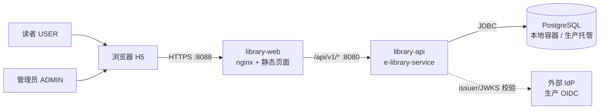
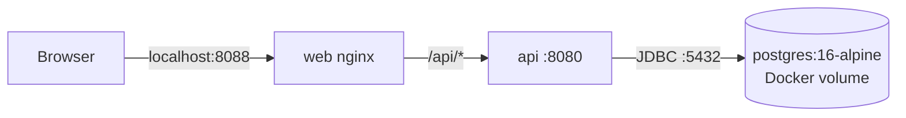
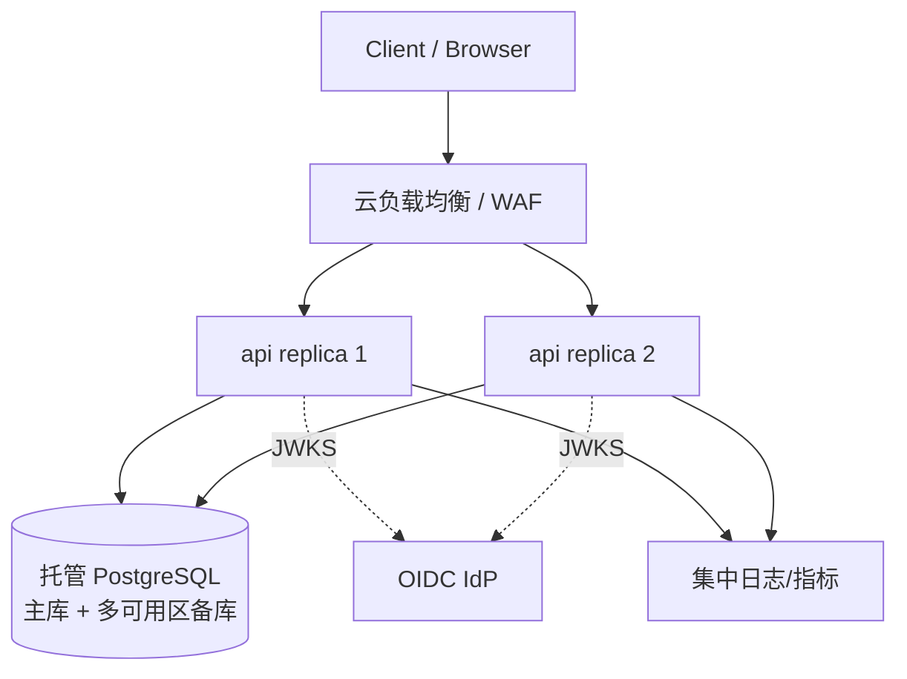
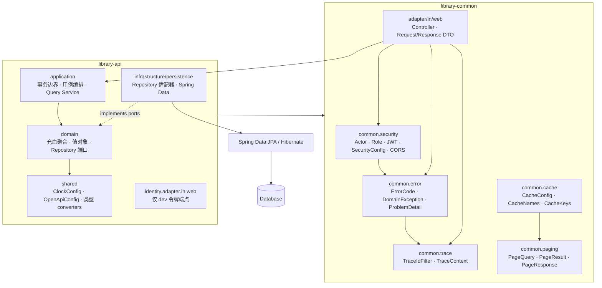

# E-Library Service 架构设计

> 状态：可运行实现  
> 版本：1.0  
> 最后更新：2026-11-08

## 1. 背景、范围与假设

### 1.1 背景

在线图书馆的核心写路径只有**借书**和**还书**，真正的难点是并发正确性：不能超借；同一用户不能同时持有同一本书的两个活跃借阅；归还必须幂等；用户只能操作自己的借阅（ADMIN 例外）；多实例部署下正确性不能依赖 JVM 内存锁。本作业覆盖这些路径，并展示分层、领域模型、安全边界、错误契约、可观测性和测试策略；它**不是**功能齐全的图书馆管理系统。

### 1.2 范围内

- 书目查询：按书名、作者、ISBN 进行不区分大小写的包含搜索，分页。
- 借阅：创建 14 天借期的借阅，校验容量和重复活跃借阅。
- 归还：只能归还活跃借阅；重复归还幂等；本人或 ADMIN 可操作。
- 身份认证与授权：JWT Bearer、`USER`/`ADMIN` 角色、方法级授权、所有权检查。
- 统一错误契约：RFC 7807 ProblemDetail、稳定错误码、traceId。
- 读路径优化：书目详情/搜索使用注解式本地缓存，借还后自动失效。
- 本地一键启动：API、H5 客户端、PostgreSQL 16 与持久卷。
- 生产拓扑说明：PG、OIDC、多实例、健康探针、优雅停机。

### 1.3 范围外

逾期调度、罚金、催还通知、预约/排队、续借、推荐、全文搜索、真实 IdP 登录页、图书管理后台、消息队列、Redis/分布式缓存、分布式锁、Kubernetes 清单。未实现原因见[未实现功能](risks-and-evolution.md#未实现功能)，演进建议见[推荐的演进顺序](risks-and-evolution.md#推荐的演进顺序)。

### 1.4 假设与约束

| 编号 | 假设/约束 |
| --- | --- |
| A1 | 令牌的 `sub` 是稳定用户标识；用户目录由外部 IdP 管理，本服务不存用户表。 |
| A2 | `roles` claim 是字符串数组，合法角色为 `USER`、`ADMIN`；缺少角色即无权访问业务 API。 |
| A3 | 借期固定 14 天；`dueAt = borrowedAt + Duration.ofDays(14)`；时间统一为 UTC `Instant`，由注入的 `Clock` 提供。 |
| A4 | `Book.totalCopies` 是当前总副本数；本项目不调整库存，不区分馆藏位置。 |
| A5 | “可借”是派生值：`totalCopies - count(ACTIVE loans)`，不在 `book` 表冗余存储。 |
| A6 | 一个用户对一本书最多一个 `ACTIVE` 借阅；归还后可以再次借同一本书。 |
| A7 | 本地开发、集成测试与生产均使用 PostgreSQL；本地通过 Compose 容器提供，生产使用托管集群。 |
| A8 | 所有业务端点都要求登录，包括书目浏览；不做匿名访问。 |
| A9 | 分页使用偏移分页；`page >= 0`，`1 <= size <= 50`。 |
| A10 | 采用模块化单体，不引入微服务、服务发现、配置中心、Kafka、Redis 或分布式锁。 |

## 2. 质量属性与权衡

| 质量属性 | 目标 | 实现方式 | 代价/权衡 |
| --- | --- | --- | --- |
| 一致性 | 绝不超借；同一用户同一书最多一个活跃借阅 | 数据库事务 + Book 行悲观锁 + 活跃计数 + 部分唯一索引 + 容量触发器 | 热门书上的借阅会串行化；吞吐上限由单行锁决定 |
| 可用性 | 应用无状态，可水平扩展；单实例故障不影响整体 | JWT、无 HTTP Session、外部化配置、readiness/liveness、优雅停机 | 数据库是唯一有状态组件；生产高可用依赖托管 PostgreSQL 的多可用区部署 |
| 性能 | 常规查询毫秒级；借阅事务短小 | 索引 `(book_id,status)`、`(user_id,status)`、`(user_id,borrowed_at DESC)`；批量读取活跃计数与书名；书目详情/搜索使用 Caffeine 注解缓存 | 搜索使用 `locate`，不适合超大目录；偏移分页深页变慢；本地缓存跨实例有 TTL 内的短暂陈旧 |
| 安全 | 身份只来自令牌；最小权限；不泄露内部细节 | OAuth2 resource server、方法级授权、所有权检查、DTO、ProblemDetail、CORS 白名单 | 本地 dev token 是刻意保留的攻击面，生产禁用 |
| 可维护性 | 领域逻辑可独立测试，适配器可替换 | web → application → domain；Repository 端口在 domain；DTO 与实体分离 | 领域对象带最小 JPA 注解，不是“纯净”的六边形模型 |
| 可观测性 | 每个请求可关联，健康状态可探测 | traceId 贯穿 API/日志/错误响应；Actuator 探针；关键业务日志 | 未内置 Prometheus/OpenTelemetry 后端 |
| 可测试性 | 核心逻辑不 mock；并发可重复验证 | 领域单测 + PostgreSQL Testcontainers 集成测试 + 真实并发请求 | 集成测试依赖 Docker，启动比纯单测慢 |
| 简单性 | 5 分钟可跑，组件数量最少 | 模块化单体、PostgreSQL 容器、nginx 直接代理 API | 放弃了部分“看起来更云原生”的基础设施 |

## 3. 系统上下文

### 3.1 上下文图

### 3.2 本地部署拓扑

Compose 启动顺序由健康检查控制：`postgres` 就绪后启动 `api`，`api` 就绪后启动 `web`。浏览器只访问 8088，属于同源请求；但 API 仍按 `Origin` 白名单校验 nginx 转发流量，因此实际访问地址（包括局域网 IP）必须列入 CORS 白名单。API 暴露到宿主机 8080，便于 curl 与 Swagger 调试；PostgreSQL 暴露 5432，便于宿主机上的 IDE 或本地应用连接。

### 3.3 生产部署拓扑

负载均衡只把流量发给 readiness 通过的实例。API 不保存会话，因此可以按 CPU/延迟水平扩容；数据库是唯一有状态组件，使用托管 PG 的多可用区部署和自动备份。H5 静态资源可由独立 nginx/CDN 托管，`/api` 反向代理到负载均衡。

## 4. 模块划分

### 4.1 Maven 模块

| 模块 | artifactId | 职责 |
| --- | --- | --- |
| `library-common` | `library-common` | 认证/授权、JWT、CORS、缓存、分页、Web 错误契约、traceId 共享内核 |
| `library-api` | `e-library-service` | 业务 API、领域模型、持久化、迁移 |
| `library-web` | `library-web` | 静态 H5、nginx 同源代理与安全响应头 |

后端是唯一的可部署业务单元；Web 是独立的表现层进程。`library-common` 是 API 的编译期依赖，不是独立服务，也不反向依赖 API。

### 4.2 包结构与依赖方向

硬性规则：

1. Controller 只依赖 application 服务，不直接使用 Repository。
2. DTO 只存在于 web 层；领域实体和 `LoanView`/`BookView` 不直接序列化给客户端。
3. application 只看到 domain 的 Repository 接口，不知道 `JpaRepository`、Hibernate 或 SQL。
4. domain 不依赖 Web、Servlet、Spring Data；JPA 注解仅作为最小持久化元数据，业务方法不调用 ORM API。
5. 聚合之间只通过 ID 引用。`Loan` 有 `bookId`，不持有 `Book` 对象；`Book` 不知道 `Loan` 的存在。
6. `library-common` 只承载认证、错误契约、trace、分页、Web 异常适配与缓存等横切能力，不得依赖 `library-api` 的业务类型。

### 4.3 各包职责

| 包 | 关键类 | 说明 |
| --- | --- | --- |
| `common.security` | `Actor`, `Role`, `CurrentUser`, `SecurityConfig`, `SecurityProperties`, JWT 配置, 401/403 handler | 调用者身份、JWT 校验、方法级授权、CORS 白名单 |
| `common.error` | `ErrorCode`, `DomainException`, `ProblemDetailsFactory`, `ProblemResponseWriter` | 稳定错误码与 RFC 7807 输出 |
| `common.trace` | `TraceContext`, `TraceIdFilter` | 关联 ID 的生成、复用与 MDC 绑定 |
| `common.cache` | `CacheConfig`, `CacheProperties`, `CacheNames`, `CacheKeys` | Caffeine 缓存管理器、逻辑缓存名与稳定 key |
| `common.paging` | `PageQuery`, `PageResult`, `PageResponse` | 传输无关的分页模型与显式 JSON 页封装 |
| `common.web` | `GlobalExceptionHandler`, `CurrentUserWebConfig` | RFC 7807 异常适配与 `@CurrentUser` 参数解析注册 |
| `catalog` | `Book`, `BookRepository`, `BookQueryService`, `BookController`, `BookPersistenceAdapter` | 书目聚合、ISBN 规范化、搜索与可借数量查询 |
| `loan` | `Loan`, `LoanStatus`, `LoanService`, `LoanQueryService`, `LoanController`, `LoanPersistenceAdapter` | 借阅聚合、状态机、借还事务、所有权检查 |
| `identity.adapter.in.web` | `DevTokenController` | 仅 dev profile 的本地令牌签发，属于 API 而非共享内核 |
| `shared` | `ClockConfig`, `OpenApiConfig`, 类型 converter | 应用级配置与跨数据库类型映射 |

### 4.4 为什么是模块化单体

- 业务只有两个写用例，独立部署不会带来团队自治收益，反而增加网络失败、分布式事务和运维成本。
- 清晰的分层和模块边界保留了未来拆分 catalog/loan 的可能，但当前不需要服务发现或消息总线。
- `library-common` 沉淀认证、错误契约、trace、分页、Web 异常适配与缓存基础设施，同时保持为普通 JAR，不引入独立服务或网络调用；业务规则和持久化适配仍留在 API。

## 详细文档

- [文档索引与推荐阅读路径](README.md)
- [领域模型与不变量](domain-model.md)
- [API 契约](api-contract.md)
- [数据模型与迁移](data-model.md)
- [借阅流程、并发与缓存](concurrency-and-cache.md)
- [安全设计](security.md)
- [高可用与运维](operations.md)
- [测试策略](testing.md)
- [风险与演进](risks-and-evolution.md)
- [关键配置](configuration.md)
