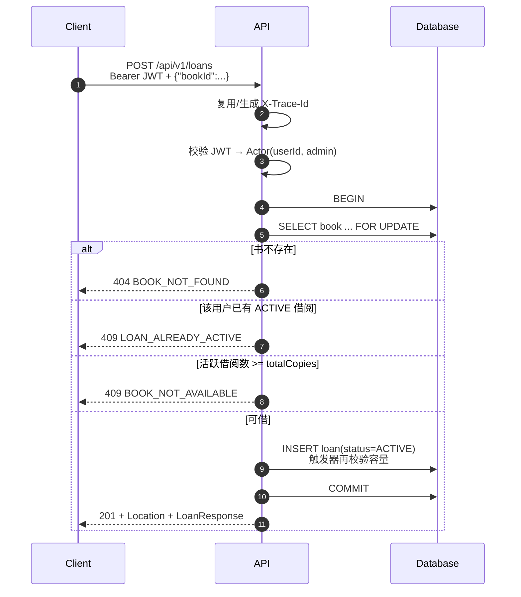
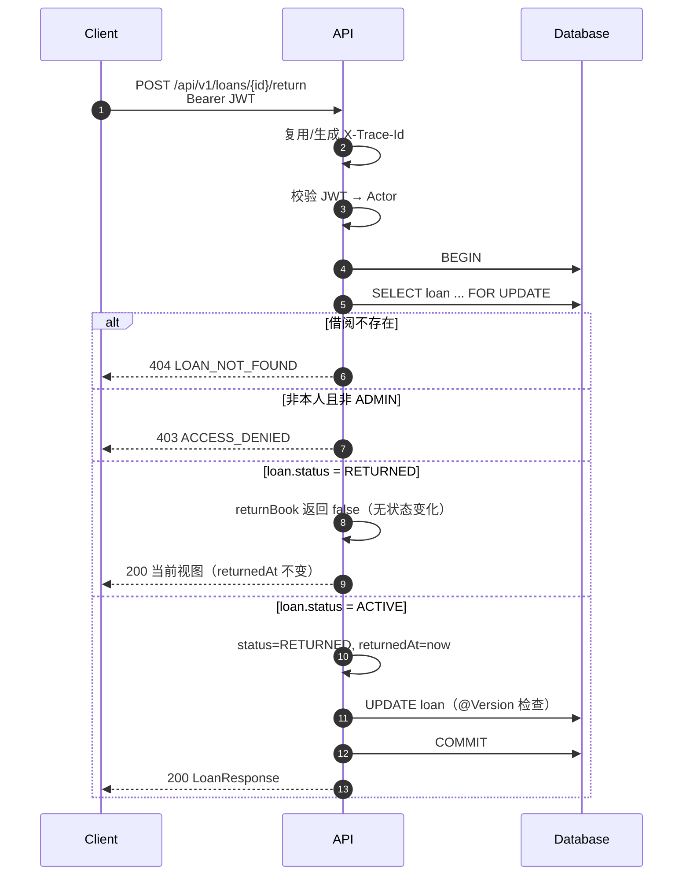

# 借阅流程、并发与缓存

## 借阅与归还时序

### 借书

认证在 API 进程内由 `library-common` 的 Spring Security 资源服务器配置完成，没有独立的 Security 服务，也没有额外网络跳转。`TraceIdFilter` 同样位于 common，由 API 在请求入口执行。

关键点：

- **先锁 Book 行，再计数**。同一本书的所有借书事务在该行上排队，后续计数读到的是前一个事务提交后的结果。
- 锁的顺序固定为“先 Book，后 Loan 插入”；没有多行交叉加锁，死锁风险低。
- 插入时数据库触发器再次检查容量；即使行锁在 SQLite 上不生效，也不会超借。
- `saveAndFlush` 让约束冲突在事务内抛出，适配器将其翻译为领域错误（部分唯一索引 → `LOAN_ALREADY_ACTIVE`，触发器标记 → `BOOK_NOT_AVAILABLE`）。

### 归还

应用层没有显式调用 `save`：`findByIdForUpdate` 返回的是受管实体，事务提交时 Hibernate 脏检查会写入更新。`@Version` 防止在锁不可用的数据库上丢失更新；触发器/状态机保证语义正确。

### 可借数量读取

- `GET /books` 先分页查书目，再按当前页的 book IDs 做一次分组计数，避免 N+1。
- `GET /books/{id}` 单独计数。
- 可借数量是**读时快照**：页面显示后可能被其他用户借走；真正借书时以事务内检查为准，客户端应对 409 `BOOK_NOT_AVAILABLE` 做刷新提示。
- 查询结果进入缓存，但借书/归还提交后会失效对应书目和搜索缓存；跨实例的缓存新鲜度边界见[缓存与高并发](#缓存与高并发)。

## 并发与一致性

### 为什么不能只靠“先查后插”

两个事务同时读到 `active=2, total=3`，都认为还剩 1 本，然后各自插入，最终 `active=4`。唯一索引只能防止同一用户重复借同一本书，不能防止不同用户超借。因此容量约束必须与计数在同一临界区内完成。

### PostgreSQL 生产方案

1. `findByIdForUpdate` 生成 `SELECT ... FOR UPDATE`，同一本书的借书事务串行化，不同书互不阻塞。
2. 在持锁事务内先检查该用户已有活跃借阅，再执行 `count(ACTIVE)`，最后插入 `loan`；重复借阅优先返回更准确的 `LOAN_ALREADY_ACTIVE`。
3. 部分唯一索引兜底“同用户同书一个活跃借阅”；BEFORE INSERT/UPDATE 触发器是单条写入的最后防线。在 READ COMMITTED 下触发器本身不是并发序列化机制，**任何新增写路径仍必须先锁 Book 行**。
4. `@Version` 检测 Book/Loan 的并发修改，冲突映射为 409 `CONCURRENT_MODIFICATION`。

隔离级别使用默认的 READ COMMITTED：所有借书方先竞争同一行锁，计数语句看到的是已提交状态；不需要 SERIALIZABLE 带来的重试成本。

### SQLite 本地方案

- SQLite 写事务本身串行化，适合单机演示，但**不支持 `SELECT ... FOR UPDATE`**（Hibernate 会忽略锁提示）。
- WAL + `busy_timeout=5000` 改善读写并发，但不改变“单写者”本质。
- JDBC URL 设置 `transaction_mode=IMMEDIATE`：事务在 `BEGIN` 时即取得 SQLite 写预留锁，而不是等到首次 INSERT。否则“先读后写”的延迟事务在另一个连接提交后会触发 `SQLITE_BUSY_SNAPSHOT`，表现为并发借书 500，且 `busy_timeout` 无法挽救已经失效的快照。
- 数据库触发器 `trg_loan_capacity_guard_insert/update` 在插入和更新时检查容量，是本地模式的最终防线。
- 部分唯一索引保证重复活跃借阅不可能出现。
- `SqliteConcurrencyIT` 用真实 SQLite 文件、12 个并发请求验证容量与同用户唯一性，并断言本地 URL 启用了 IMMEDIATE 模式。
- 因此 SQLite 版本在单实例下仍然正确，但**不具备多实例高可用能力**；生产必须切换到 PostgreSQL。

### 归还并发

- 归还先锁 `loan` 行（PG），两个并发归还请求串行。
- 第一个请求将状态改为 `RETURNED` 并提交；第二个请求随后读到 `RETURNED`，`returnBook` 返回 `false`，返回同一个 `returnedAt`。
- SQLite 上写事务以 IMMEDIATE 模式串行化，并发归还仍由聚合的 `returnBook` 收敛到同一个 `returnedAt`；`@Version` 继续防御异常路径，冲突映射为 409 `CONCURRENT_MODIFICATION`，客户端可安全重试。

### 多实例

- JWT 无状态认证，无 Session，任何实例都能处理任何请求。
- 书目缓存是进程内缓存，只加速读路径，不参与容量判断；多实例下其他节点的失效最多延迟一个 TTL。正确性仍由数据库行锁和约束保证。
- 不使用 `synchronized`、`ConcurrentHashMap` 锁或本地锁保护业务不变量；协调点是数据库行锁和约束。
- API 可水平扩容；SQLite 部署仅限单实例。
- 未使用分布式锁：数据库事务本身已经提供所需临界区，Redis 锁会引入额外故障模式和 TTL 正确性问题。

### 失败与重试

| 场景 | 结果 | 客户端建议 |
| --- | --- | --- |
| 并发超借 | 一个成功，其余 409 `BOOK_NOT_AVAILABLE` | 刷新可借数量，不要盲目重试 |
| 重复借同一本 | 409 `LOAN_ALREADY_ACTIVE` | 跳转到已有借阅 |
| 重复归还 | 200，状态不变 | 视为成功 |
| 乐观锁冲突 | 409 `CONCURRENT_MODIFICATION` | 读取最新状态后重试 |
| 数据库不可用 | 500/503，readiness 失败 | 负载均衡摘除实例；客户端退避重试 |
| 进程收到 SIGTERM | 优雅停机，进行中的请求完成（最多 20s） | 依赖 LB 先摘流 |

### 缓存与高并发

书目是典型的读多写少数据，热点集中在 `GET /books` 和 `GET /books/{id}`。缓存采用 Spring Cache 注解 + Caffeine，配置与逻辑缓存名沉淀在 `library-common` 的 `common.cache`。

- **缓存范围**：`BookQueryService.searchBooks` 使用 `@Cacheable("bookSearch")`，key 为归一化查询词 + page + size；`getBook` 使用 `@Cacheable("bookById")`，key 为 bookId。缓存值是应用层不可变视图，不缓存 JPA 实体。
- **击穿保护**：两个方法都设置 `sync = true`，同一 key 的并发 miss 只回源一次，其余请求等待结果，避免热点书被大量并发查询同时打到数据库。
- **容量与过期**：默认 TTL 30s、最多 10000 条，可通过 `ELIBRARY_CACHE_TTL`/`ELIBRARY_CACHE_MAX_SIZE` 调整。TTL 同时兜底跨实例和漏失效场景。
- **写后失效**：借书/归还成功后，`LoanService` 在事务内发布 `BookAvailabilityChangedEvent`；`BookCacheInvalidator` 使用 `@TransactionalEventListener(AFTER_COMMIT)` 和 `@Caching(evict=...)`，在提交后删除该书详情缓存并清空搜索缓存。若在提交前删除，并发读可能把旧的 `availableCopies` 重新写回缓存。
- **不变量不依赖缓存**：可借数量仍由 `Book` 行锁、活跃借阅计数、部分唯一索引和触发器在事务内保证；缓存未命中、失效或延迟只会影响展示新鲜度，不会导致超借。
- **多实例边界**：Caffeine 是进程内缓存，失效事件只清理当前实例；其他实例最迟在 TTL 后看到新值。若业务要求跨实例立即一致，可把 `CacheManager` 替换为 Redis（并增加失效广播），业务方法上的 `@Cacheable`/`@CacheEvict` 不需要改动。当前不引入 Redis，是因为它增加一个必须高可用的组件，而现有规模没有这个必要性。

