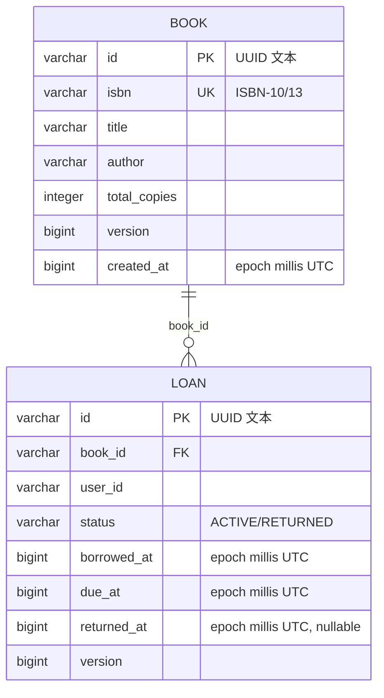

# 数据模型与约束

## 表结构与迁移

### ER 图



### 表与约束

`book`：

- 主键 `id`；`isbn` 唯一；`total_copies > 0`；`version` 由 Hibernate 乐观锁维护。
- `created_at` 存 epoch 毫秒，排序与比较语义明确。

`loan`：

- 主键 `id`；外键 `book_id → book(id)`。
- `ck_loan_status` 限制 `ACTIVE`/`RETURNED`。
- `ck_loan_returned_at` 保证状态与归还时间一致：
  - `ACTIVE` 必须有 `returned_at IS NULL`；
  - `RETURNED` 必须有非空 `returned_at`。
- `ck_loan_due_date` 保证 `due_at = borrowed_at + 1209600000`（14 天，单位毫秒）。
- 部分唯一索引 `uq_loan_active_user_book`：只对 `status='ACTIVE'` 生效，因此历史归还记录不会阻止再次借阅。
- 容量触发器：插入或状态变为 `ACTIVE` 时，统计同一本书的活跃借阅数，达到 `total_copies` 则中止事务。

### 索引

| 索引 | 列 | 服务的查询 |
| --- | --- | --- |
| `uq_book_isbn` | `book(isbn)` | ISBN 唯一性、按 ISBN 精确查找 |
| `uq_loan_active_user_book` | `loan(user_id, book_id) WHERE status='ACTIVE'` | 重复活跃借阅兜底；按用户+书查活跃记录 |
| `idx_loan_user_status` | `loan(user_id, status)` | `/me/loans` 状态过滤与分页 |
| `idx_loan_user_borrowed` | `loan(user_id, borrowed_at DESC)` | 我的借阅按借出时间倒序 |
| `idx_loan_book_status` | `loan(book_id, status)` | 活跃计数、容量触发器 |

书目搜索使用 `lower(title/author/isbn) + locate`，没有为包含搜索建 B-tree 索引；这是当前数据量下的有意简化。大规模部署应改为 PostgreSQL `pg_trgm` 或 FTS，并采用游标分页。

### 迁移策略

```
db/migration/common/V1__create_schema.sql       表、约束、索引
db/migration/postgresql/V2__loan_capacity_guard.sql PG 触发器函数
db/seed/V3__seed_books.sql                      仅 dev profile 的 8 本种子书
```

- Flyway locations：`common` + `postgresql`；`dev` profile 额外包含 `seed`；测试/生产不加载 seed。
- Hibernate 使用 `ddl-auto: validate`，不会悄悄改表。
- 迁移只前进，不在运行时自动改结构；生产发布应先在预发验证。
- Flyway 在 PostgreSQL 上使用 schema history 锁，多个实例同时启动时会串行执行迁移。

### 类型映射

- UUID 统一存为 `VARCHAR(36)`；主键字段使用 `@JdbcTypeCode(SqlTypes.VARCHAR)`，非主键 UUID 使用 `AttributeConverter`，映射不依赖数据库原生 UUID 类型。
- `Instant` 通过 `AttributeConverter` 存为 epoch 毫秒 `BIGINT`，避免不同数据库 timestamp 类型的差异。
- 时间在写入前截断到毫秒，保证 API 响应与数据库值一致。
