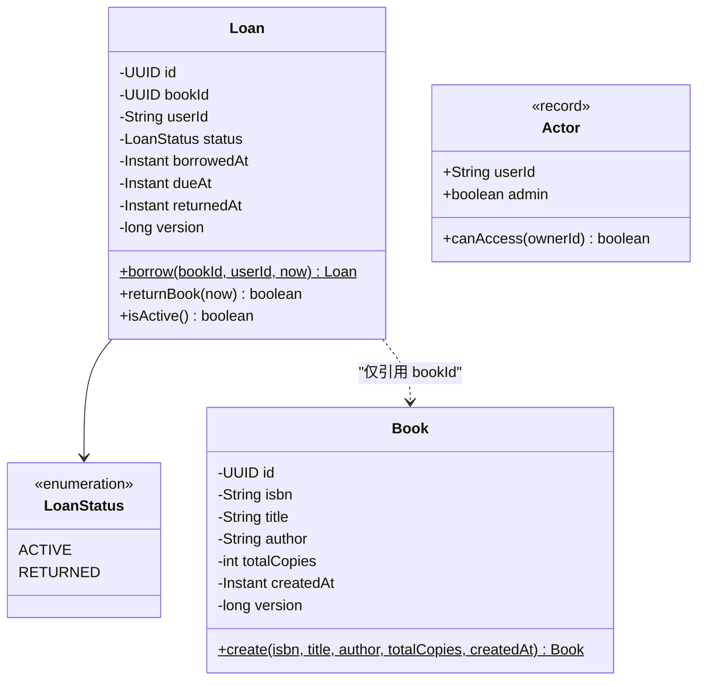
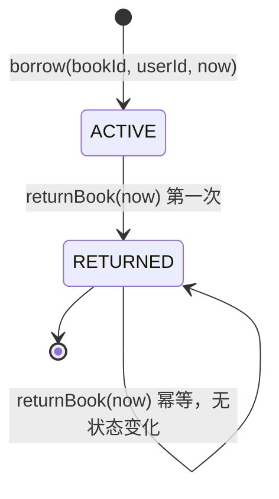

# 领域模型与不变量

## 聚合与不变量

### 限界上下文

| 上下文 | 聚合根 | 职责 |
| --- | --- | --- |
| Catalog | `Book` | 书目元数据、总副本数、ISBN 规范化 |
| Loan | `Loan` | 借阅生命周期、借期、归还状态 |
| Identity | `Actor`（非持久化） | 从令牌得到的调用者与角色 |
| Shared | — | 分页、错误、时间、持久化基础类型 |

### 聚合与值对象

设计要点：

- **无 setter**：`Book` 通过静态工厂创建后不可变；`Loan` 只能由 `borrow` 工厂创建，状态只能通过 `returnBook` 改变。
- **业务方法承载规则**：借期计算、毫秒截断、状态转换、幂等归还都在聚合内部完成，application 不拼接字段。
- **聚合间按 ID 引用**：`Loan` 不加载 `Book` 集合；返回书名时由 application 批量查询并组装 view。
- **可借性是查询派生值**：`Book` 只保存 `totalCopies`，避免在 `book` 表维护一个容易与借阅数据不一致的 `availableCopies` 字段。

### 借阅状态机

`returnBook` 返回 `boolean`：`true` 表示本次调用改变了状态，`false` 表示此前已归还。application 在两种情况下都返回当前借阅视图，且保留第一次归还的 `returnedAt`。

### 核心不变量与执行层次

| 编号 | 不变量 | 领域/应用层 | 数据库层 |
| --- | --- | --- | --- |
| I1 | 活跃借阅数 ≤ `Book.totalCopies` | 借书事务锁 Book 行后计数并判断 | `trg_loan_capacity_guard` 触发器兜底；并发序列化依赖行锁 |
| I2 | 同一用户同一书最多一个 `ACTIVE` 借阅 | 借书前查询已有活跃借阅 | 部分唯一索引 `uq_loan_active_user_book (user_id, book_id) WHERE status='ACTIVE'` |
| I3 | 只有 `ACTIVE` 可归还；重复归还幂等 | `Loan.returnBook` 内状态判断 | `ck_loan_status`、`ck_loan_returned_at` |
| I4 | `dueAt = borrowedAt + 14 天`，UTC，注入 Clock | `Loan.borrow` 计算并截断毫秒 | `ck_loan_due_date` 校验精确差值 |
| I5 | 只能查看/归还自己的借阅，ADMIN 例外 | `Actor.canAccess` + service 检查 | 不适用（授权在应用层） |
| I6 | `totalCopies >= 1`；ISBN 唯一且格式合法 | `Book.create` 校验、ISBN 规范化 | `ck_book_total_copies`、`uq_book_isbn` |

不变量不是“只靠代码自觉”：应用层负责给出准确的业务错误，数据库约束作为最后防线。即使绕过服务、并发执行或未来新增写入口，数据库也不会产生超借或非法状态。
